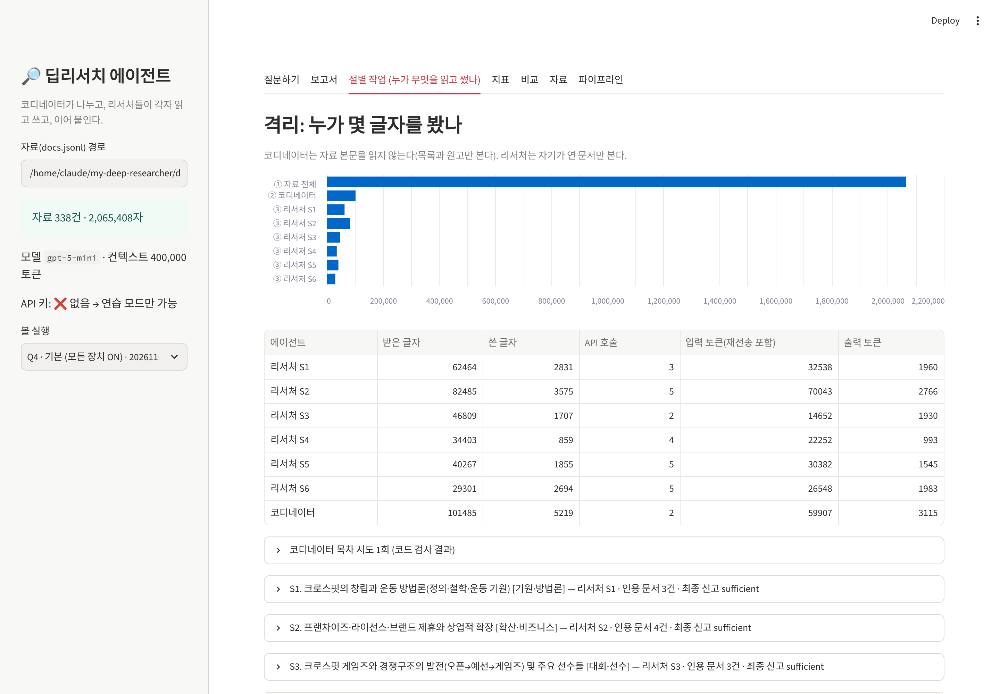

# my-deep-researcher — 크로스핏 딥리서치 에이전트

자료가 컨텍스트 윈도우 하나에 다 들어가지 않을 때, **코디네이터**가 목차를 짜서 구역을 나눈다. **리서처 서브에이전트**들은 각자 읽은 자료만 컨텍스트에 둔 채 자기 절을 쓰고, 그 원고를 이어 붙여 장문 보고서를 만든다. 파이프라인은 LangGraph로 짰다.

설계·지표·실험 결과·화면 캡처·회고는 [REPORT.md](REPORT.md)에 있다.



```
my-deep-researcher/
├── data/            # corpus.json (docs + links) · questions.json (질문과 "왜 나눌 만한가") · seeds.txt
├── config.json      # 도메인에 묶인 값 (절 수 · 절 예산 · 바퀴 상한 · 관문 기준 · 역할 명단)
├── graph.py         # 기획 → 배치(Send) → 서브에이전트 → 점검 → 종합 → 측정 (LangGraph)
├── metrics.py       # 지표 — 정답표도 판정 모델도 쓰지 않는다
├── ablation.py      # 스위치를 하나씩 끄고 평가하는 실험
├── baseline.py      # 단일 에이전트 대조군 (같은 목차·자료·도구·총예산)
├── app.py           # 데모 (Streamlit)
├── agents/          # 코디네이터·리서처·읽기 도구·프롬프트·보고서 조립
├── build_corpus.py  # 위키백과에서 자료 모으기 (data/corpus.json 생성)
├── corpus_stats.py  # 자료 총량 vs 컨텍스트 윈도우, 링크 통계
├── tokens.py        # 토큰 세기 (tiktoken, 없으면 어림값)
├── output/          # runs.jsonl · ablation.json · ablation_<질문>.md · reports/ · traces/
├── tests/           # 인터넷·API 없이 도는 시험
├── docs/            # 데모 화면 캡처 · pipeline.mmd (코드에서 뽑은 그래프)
└── REPORT.md
```

## 실행 (Windows 명령 프롬프트 기준)

```
python -m pip install -r requirements.txt
copy .env.example .env          # 메모장으로 .env 를 열어 OPENAI_API_KEY 를 넣는다
python corpus_stats.py          # 자료 338건이 컨텍스트 윈도우의 몇 배인지 확인
python ablation.py --q Q4       # 기본 · 장치 OFF 3종 · 단일 대조군, 보고서 5편 + 비교표
python graph.py --q Q1          # 나누지 말아야 하는 질문(문서 한 건으로 답이 나옴)
streamlit run app.py            # 데모 화면 (http://localhost:8501)
```

- `python` 이 안 되면 `py` 로 바꾼다.
- `.env` 가 다른 프로그램(예: 보안 프로그램)으로 열리면 `notepad .env` 로 연다.
- API 없이 흐름만 보려면 명령 뒤에 `--practice` 를 붙인다(가짜 모델, 비용 없음).
- 자료를 처음부터 다시 모으려면 `python build_corpus.py` (5~10분, 위키백과 요청 사이에 1초씩 쉰다. 중간에 멈춰도 다시 실행하면 이어서 한다).

## 시험

```
python -m tests.test_build_corpus    # 자료 수집기 (가짜 위키백과 응답, 429 재시도, 캐시·오프라인)
python -m tests.test_pipeline        # 목차 검사 · 병합 규칙 · 5가지 변형 · LangGraph 병렬 실행
python -m tests.test_openai_shape    # GPT 요청 모양 (가짜 OpenAI 클라이언트)
```

## 공개할 때

- `.env`(API 키)는 `.gitignore` 에 들어 있어 올라가지 않는다. 배포하는 경우에도 키는 서비스의 비밀 값 설정에 넣는다.
- 자료는 영문 위키백과(CC BY-SA 4.0)다. 보고서 참고문헌에 문서 주소가 들어간다.
