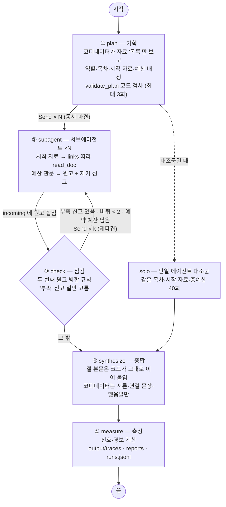
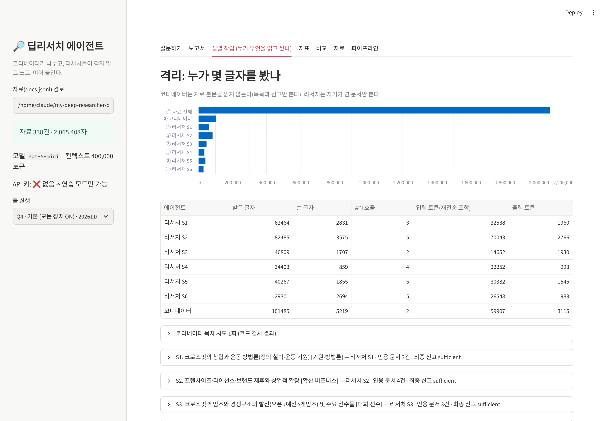
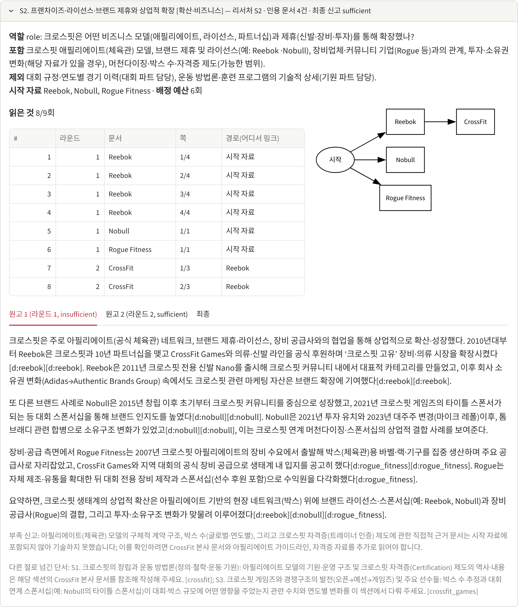
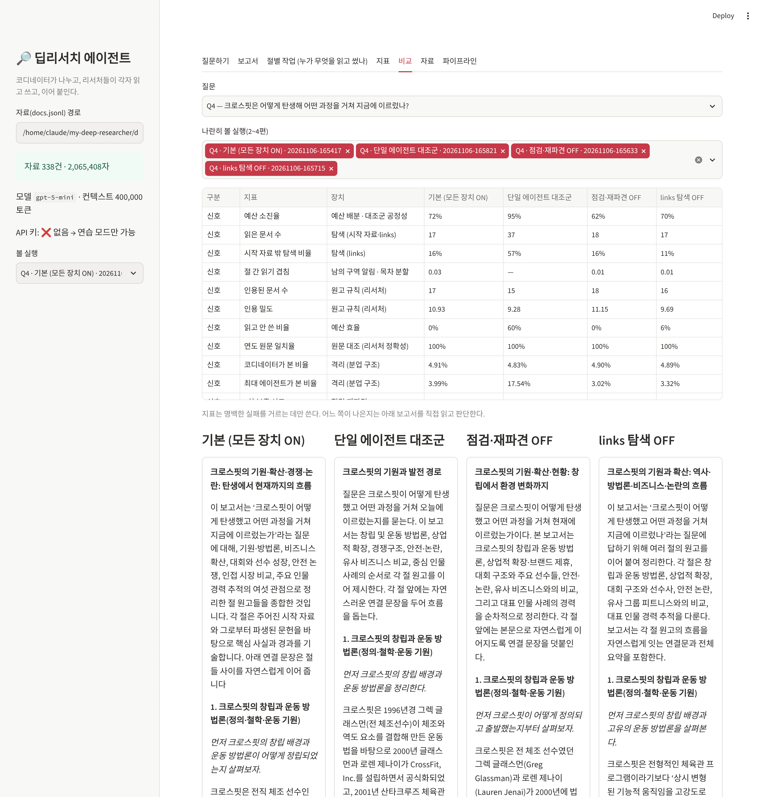
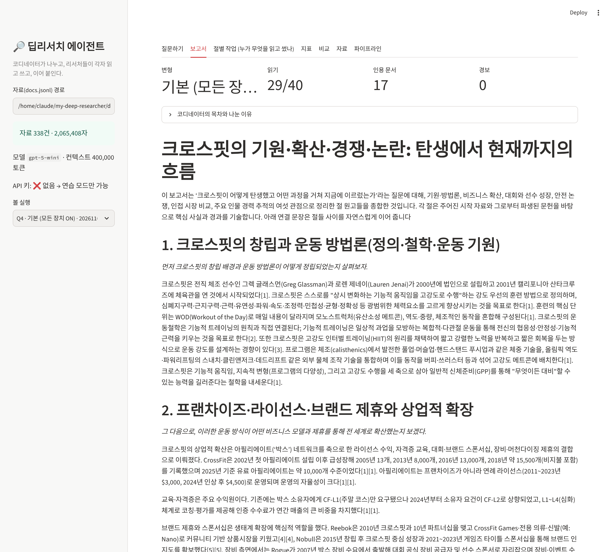
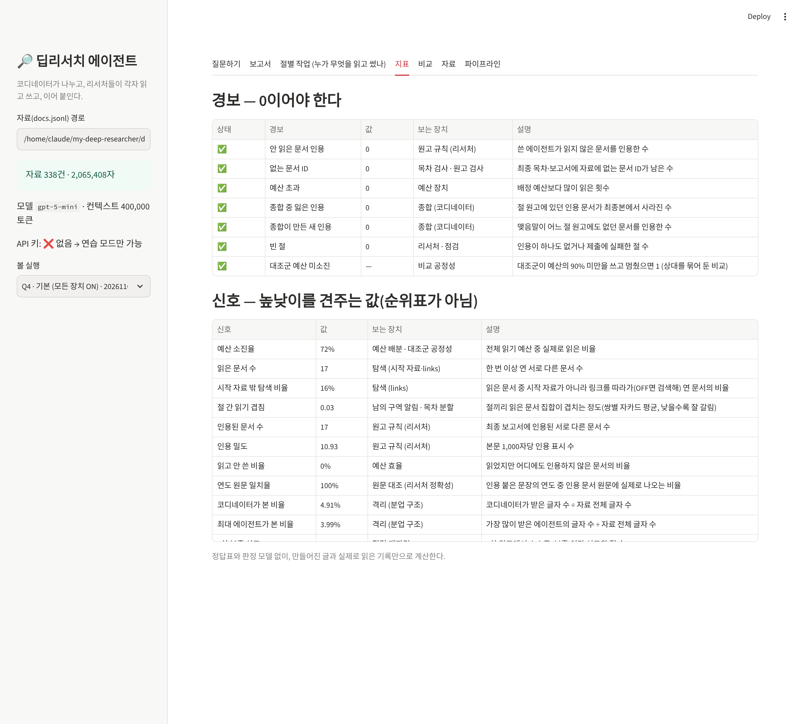
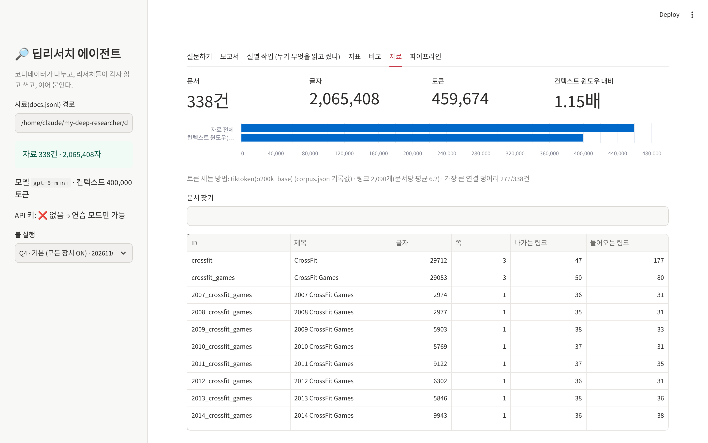
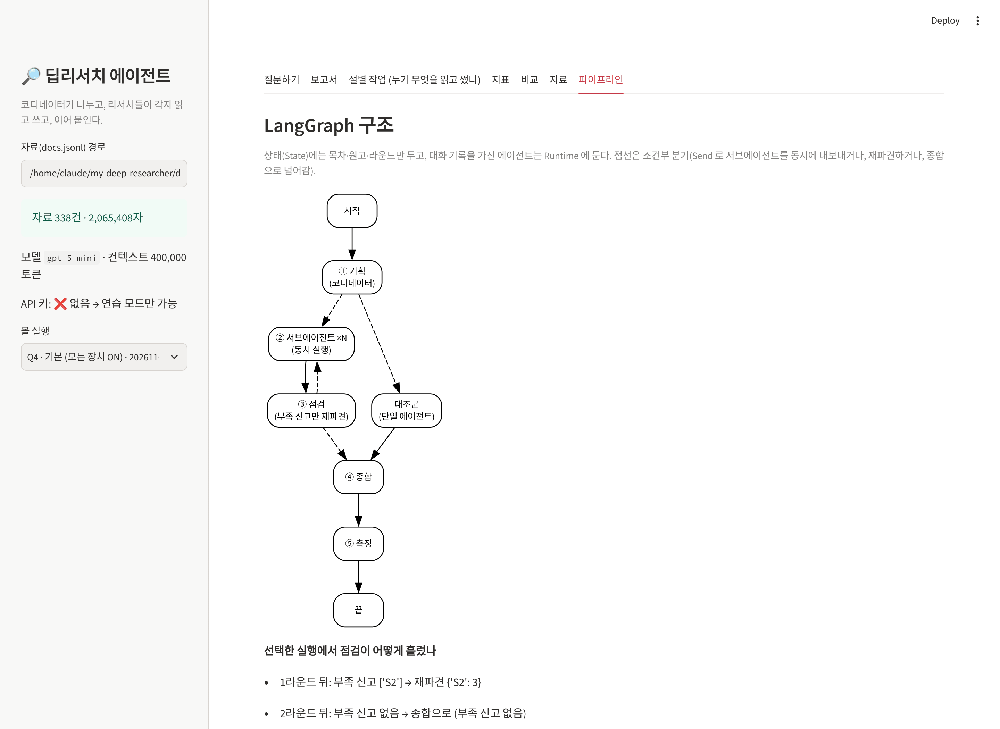

# REPORT — 크로스핏 딥리서치 에이전트

> 수업에서는 한국 근대사를 소재로 삼았지만, 배운 것은 역사가 아니라 **분업**이었다. 컨텍스트 윈도우 하나에 다 들어가지 않는 자료를 코디네이터가 구역으로 나눠 맡긴다. 리서처들은 각자 읽은 자료만 컨텍스트에 둔 채 자기 몫을 쓴다. 그 원고를 이어 붙여 장문을 만든다. 이 구조를 내 분야인 **크로스핏**에 옮겼다.

- 저장소 구성과 실행 방법: [README.md](README.md)
- 모델: OpenAI `gpt-5-mini` (컨텍스트 윈도우 400,000 토큰, reasoning effort low)
- 파이프라인: LangGraph (`graph.py`)

---

## 1. 주제와 코퍼스

### 왜 크로스핏인가

나는 크로스핏·하이록스·기능성 운동을 가르치는 사람이다. 크로스핏의 역사는 이 구조를 시험하기에 알맞은 소재였다. 이야기가 여러 갈래로 흩어져 있기 때문이다.

- **창립과 방법론**: 창업자, 피트니스의 정의, 운동 방법론
- **비즈니스**: 제휴(어필리에이트) 모델과 박스 확산, 후원사, 소유권 변화
- **대회**: 2007년부터 해마다 따로 있는 크로스핏 게임즈 문서 20건 가까이
- **논쟁**: 부상·횡문근융해증·소송·2020년 파문
- **인접 종목**: 하이록스, F45 같은 그룹 피트니스

한 문서만 읽어서는 답이 안 나오고, 갈래마다 읽어야 할 문서가 다르다. 반대로 "누가 설립했나"처럼 문서 한 건으로 끝나는 질문도 쉽게 만들 수 있다. 그래서 이 구조를 **쓰면 안 되는 경우**도 함께 보일 수 있다.

### 코퍼스: 영문 위키백과 338건, 컨텍스트 윈도우의 1.15배

| 항목 | 값 |
|---|---|
| 문서 수 | **338건** (seeds 79건 + 확장 262건 − 중복. 이 중 동음이의 목록 문서 15건은 표시만 하고 기획 단계에서 제외) |
| 총 글자 수 | 2,065,408자 |
| 총 토큰 수 | **459,674 토큰** (tiktoken `o200k_base` 실측) |
| 컨텍스트 윈도우 (gpt-5-mini) | 400,000 토큰 |
| 배수 | **1.15배** → 한 에이전트가 자료 전체를 한 번에 볼 수 없다 |
| 문서끼리의 링크 (`links`) | 2,090개 (문서당 평균 6.2개), 가장 큰 연결 덩어리 277/338건 |
| 많이 가리켜지는 문서 | CrossFit(177), CrossFit Games(80), 2019 CrossFit Games(49), 2020(46), 2018(45) |

**수집 방법** (`build_corpus.py`)
1. `data/seeds.txt` 의 85개 제목(본체, 연도별 게임즈, 선수, 인접 종목, 후원사, 단체, 방법론, 영양)을 위키백과 API로 받는다.
2. 총량이 컨텍스트 윈도우 × 1.2를 넘을 때까지 문서를 더 받는다. 후보는 'CrossFit'을 언급하는 문서 중, 이미 받은 문서들이 많이 링크하는 것부터 고른다.
3. 문서마다 본문에 걸린 위키 링크 중 **코퍼스 안의 문서를 가리키는 것만** `links` 로 남긴다. 넘겨주기(redirect) 이름도 정식 문서로 이어 준다.
4. 위키백과가 "요청이 너무 많다(HTTP 429)"고 막지 않도록 요청 사이에 1초씩 쉰다. 받은 문서는 바로 캐시에 저장해, 중간에 멈춰도 이어서 받는다.

**수집하며 겪은 일**
- 1차 수집에서는 확장 문서가 'CrossFit'을 **2번 이상** 언급해야 받았다. 그 결과 168건, 287,334 토큰(0.72배)으로 컨텍스트 윈도우를 넘지 못했다.
- 기준을 **1번 이상**으로 낮추고, 받아 둔 캐시만으로 다시 묶어(`--offline --min-mentions 1`) 338건, 1.15배가 됐다.
- 대가로 크로스핏을 한 번만 언급하는 주변 문서(선수 출신지 연표 등)가 섞였다. 이런 문서는 대부분 다른 문서가 가리키지 않는다(들어오는 링크 0인 문서 195건). 그래서 links 를 따라가는 리서처가 열 일은 드물다.

### 질문 세트 (`data/questions.json`) — 정답표 없이 "왜 나눌 만한가"만 적었다

| ID | 유형 | 질문 | 왜 나눌 만한가 |
|---|---|---|---|
| Q1 | 한 건으로 답 | 크로스핏은 누가, 언제 설립했나? | **나눌 이유가 없다**: 'CrossFit' 문서 첫 부분에 답이 있다 |
| Q2 | 한 건으로 답 | 하이록스 경기는 어떤 종목으로, 어떤 순서로? | **나눌 이유가 없다**: 'Hyrox' 문서 한 건 |
| Q3 | 한 건으로 답 | '머프'의 이름은 누구에게서 왔나? | **나눌 이유가 없다**: 'Michael P. Murphy' 문서 한 건 |
| Q4 | 여러 갈래 | 크로스핏은 어떻게 탄생해 지금에 이르렀나? | 창립·확산·게임즈·논란·소유권이 서로 다른 문서와 연도별 대회 문서에 흩어져 있다 |
| Q5 | 여러 갈래 | 주요 비판과 논쟁, 그 근거는? | 의학·단체·대회 문서로 갈래마다 근거 문서가 다르다 |
| Q6 | 여러 갈래 | 방법론과 영양 철학은 어디서 왔나? | HIIT·체조·역도·팔레오·존 다이어트가 각각 다른 문서 |
| Q7 | 여러 갈래 | 크로스핏·하이록스·F45·오렌지띠어리 비교 | 대상마다 문서가 따로, 비교 기준도 갈린다 |
| Q8 | 한 대상 추적 | 티아-클레어 투미의 경력 | 역도(올림픽) → 연도별 게임즈 → 하이록스로 따라가야 한다 |
| Q9 | 한 대상 추적 | 게임즈 예선·출전 방식의 해마다 변화 | 연도별 문서 20건 가까이를 따라가야 한다 |
| Q10 | 한 대상 추적 | 리복과 크로스핏의 관계 | 경계 사례: 갈래가 적어 나누는 이득이 작을 수 있다 |

Q1~Q3은 일부러 넣었다. 코디네이터는 이런 질문에 절을 1개만 만들고 역할을 '단일 사실 확인'으로 고르도록 지시받는다(아래 결과 참고).

---

## 2. 분업 설계

### 역할 명단 (`config.json` → `roles`)

도메인에 묶인 값은 코드가 아니라 `config.json` 에 모았다. 절 수(1~6), 총 읽기 예산(40회)과 재파견 예약(6회), 절 최소 예산(2회), 재파견 바퀴 상한(2), 관문 기준, 그리고 역할 명단이 여기에 들어 있다.

| 역할 | 맡는 내용 |
|---|---|
| 기원·방법론 | 창립자, 초기 체육관, 피트니스의 정의, 영양 철학, 방법론의 뿌리(HIIT·체조·역도) |
| 확산·비즈니스 | 제휴 모델, 박스 수, 자격증, 해외 확산, 후원사, 소유권 변화 |
| 대회·선수 | 크로스핏 게임즈, 오픈, 예선·출전 방식, 연도별 대회, 챔피언 |
| 안전·논쟁 | 부상과 횡문근융해증, 연구 근거, 소송, 사회적 논란과 위기 |
| 인접 종목·시장 | 하이록스, F45, 오렌지띠어리 등 그룹 피트니스와의 비교 |
| 인물 추적 | 한 선수·인물을 시기별 문서로 따라가 경력을 재구성 |
| 단일 사실 확인 | 문서 한두 건으로 답이 나오는 질문(나누지 않는 경우) |

### 코디네이터의 배정 규칙과 코드 검사

코디네이터는 **자료 본문을 읽지 않는다**. 보는 것은 자료 목록뿐이다. 목록에는 문서마다 ID, 제목, 분량, 링크 수, 첫 220자가 들어 있다. 이 목록을 보고 절마다 다음을 정해 JSON(strict schema)으로 낸다.
- 역할(명단에서 고름)과 제목
- 역할 질문(이 절이 답할 질문)
- 포함 범위와 제외 범위
- 시작 자료 1~4건과 읽기 예산

**목차는 내용 단위로 나눈다.** 형식 단위('서론/본론/결론')로 나누면 리서처 전부가 같은 자료를 읽게 된다.

모델은 그럴듯한 제목과 문서 ID를 지어낸다. 그래서 `validate_plan()` 이 코드로 검사하고, 오류가 있으면 이유를 붙여 다시 짜게 한다(최대 3회).

| 검사 | 왜 |
|---|---|
| 시작 자료 ID가 실제 코퍼스에 있는가 | 지어낸 ID 차단 |
| 동음이의(이름 목록) 문서를 시작 자료로 골랐는가 | 1차 실행에서 'Glassman(성씨 목록)'을 창업자 문서로 착각해 배정했다 |
| 제목이 서론·결론·개요·요약 같은 형식 단위인가 | 내용 단위 분할 강제 |
| 두 절의 시작 자료가 50% 이상 겹치는가 | 같은 자료를 여럿이 읽는 분할 차단 |
| 역할이 명단에 있는가 / '단일 사실 확인'은 절이 하나일 때만 | 역할 명단 강제 |
| 절 예산 ≥ 2, ≥ 시작 자료 수, 합계 ≤ (총예산 − 재파견 예약) | 예산 규칙 |

### 서브에이전트(리서처) 설계 규칙

- **구역**: 절 하나만 맡는다. 브리핑에 다른 절의 제목·역할·포함 범위·시작 자료가 함께 들어간다(남의 구역 알림). 범위 밖에서 찾은 것은 쓰지 않고 `handoffs` 로 넘긴다.
- **탐색 = links**: `read_doc` 은 시작 자료와 **이미 읽은 문서가 링크하는 문서**만 연다. 그 밖의 문서는 코드가 막는다. `list_links` 는 예산을 쓰지 않는다.
- **예산**: `read_doc` 1회는 1쪽(최대 12,000자)이고 예산 1회다. 예산을 넘는 읽기는 코드가 막는다.
- **원고 규칙**: 700~1,600자, 사실마다 `[d:문서ID]` 인용, 직접 읽은 문서만 인용한다.
  - 인용이 없는 원고는 코드가 거절한다.
  - 읽지 않은 문서를 인용하면 한 번 돌려보낸다. 그래도 고치지 않으면 받되 경보로 남긴다.
- **예산 관문** (2차 버전에서 추가): 예산의 60%를 쓰지 않았거나 시작 자료를 다 읽지 않았으면, 코드가 제출을 돌려보낸다. 이때 안 읽은 시작 자료와 링크로 열 수 있는 문서 목록을 함께 보여 준다(라운드당 최대 2회).
- **자기 신고**: 네 가지를 스스로 점검하고, 하나라도 '아니오'면 `insufficient` 로 신고한다.
  - 역할 질문에 답했나
  - 포함 범위를 다 다뤘나
  - 주장마다 인용이 있나
  - 시작 자료와 필요한 링크 문서를 읽었나

### 점검과 재파견, 두 번째 원고 규칙

- 스스로 '부족'이라 신고한 절만 다시 내보낸다.
  - 재파견 예산은 처음부터 예약해 둔 6회 안에서 절당 최대 3회다.
  - **바퀴 수 상한은 2**다.
  - 다른 리서처가 그 절로 넘긴 단서(`handoffs`)를 함께 전한다.
- **두 번째 원고는 무조건 덮어쓰지 않는다** (`merge_drafts`).
  - 새 원고가 이전 원고의 인용 문서를 하나도 잃지 않았고 안 읽은 문서 인용이 늘지 않았을 때만 **교체**한다.
  - 아니면 이전 원고를 지키고, 이전에 없던 문서를 인용한 문단만 덧붙인다(**보강**).
  - 이유: 무조건 덮어쓰면 인용을 빠뜨린 원고가 멀쩡한 원고를 지운다.

### 종합

절 본문은 **코드가 그대로 이어 붙인다**. 코디네이터는 제목, 서론, 절 사이 연결 문장, 맺음말만 쓴다. 모델에게 본문을 다시 쓰게 하면 인용이 빠지거나 엉뚱한 문장으로 옮겨 붙기 때문이다. 코디네이터가 이 단계에서 받는 것은 원고뿐이고, 원문은 받지 않는다.

### 격리를 숫자로

에이전트마다 **받은 글자 수**(시스템·사용자 메시지와 도구 결과)를 따로 센다(`agents/llm.py` 의 `Conversation`). 코디네이터는 자료 목록과 원고만, 리서처는 자기가 연 쪽만 받는다. 그래서 자료 전체(2,065,408자)와 비교하면 격리가 숫자로 드러난다. 결과는 5절 표와 데모의 '격리' 막대에 있다.

### 대조군 (`baseline.py`)

에이전트 1명이 **같은 자료, 모델, 도구, 목차와 시작 자료(기본 실행의 것을 재사용), 총예산 40회**로 모든 절을 쓴다. 예산의 90%를 쓰지 않고 끝내려 하면 코드가 안 읽은 자료를 보여 주며 최대 6회 돌려보낸다. 그래도 멈추면 `대조군 예산 미소진` 경보가 울린다. 중간에 멈춘 대조군을 이기는 것은 상대를 묶어 둔 비교이기 때문이다.

---

## 3. 지표 — 정답표도 판정 모델도 쓰지 않는다

재료는 **만들어진 글**(보고서·절 원고)과 **실제로 읽은 기록**(읽기 로그)뿐이다. 지표마다 어느 장치를 보는지 적었다. 높낮이를 견주는 **신호**와 0이어야 하는 **경보**를 갈랐다. 설명이 한 줄로 안 되는 지표는 넣지 않았다(`metrics.py`).

**경보 — 0이어야 한다**

| 경보 | 보는 장치 | 한 줄 설명 |
|---|---|---|
| 안 읽은 문서 인용 | 원고 규칙 (리서처) | 쓴 에이전트가 읽지 않은 문서를 인용한 수 |
| 없는 문서 ID | 목차 검사 · 원고 검사 | 최종 목차·보고서에 자료에 없는 ID가 남은 수 |
| 예산 초과 | 예산 장치 | 배정 예산보다 많이 읽은 횟수 |
| 종합 중 잃은 인용 | 종합 (코디네이터) | 절 원고의 인용 문서가 최종본에서 사라진 수 |
| 종합이 만든 새 인용 | 종합 (코디네이터) | 맺음말이 어느 절에도 없던 문서를 인용한 수 |
| 빈 절 | 리서처 · 점검 | 인용이 없거나 제출에 실패한 절 수 |
| 대조군 예산 미소진 | 비교 공정성 | 대조군이 예산의 90% 미만을 쓰고 멈췄으면 1 |

**신호 — 순위표가 아니라 어디를 고칠지 가리키는 값**

| 신호 | 보는 장치 | 한 줄 설명 |
|---|---|---|
| 예산 소진율 | 예산 배분 · 공정성 | 전체 예산 중 실제로 읽은 비율 |
| 읽은 문서 수 | 탐색 (시작 자료·links) | 한 번 이상 연 서로 다른 문서 수 |
| 시작 자료 밖 탐색 비율 | 탐색 (links) | 읽은 문서 중 링크를 따라가(OFF면 검색해) 연 문서의 비율 |
| 절 간 읽기 겹침 | 남의 구역 알림 · 목차 분할 | 절끼리 읽은 문서가 겹치는 정도(쌍별 자카드 평균) |
| 인용된 문서 수 | 원고 규칙 | 최종 보고서에 인용된 서로 다른 문서 수 |
| 인용 밀도 | 원고 규칙 | 본문 1,000자당 인용 수 |
| 읽고 안 쓴 비율 | 예산 효율 | 읽었지만 인용하지 않은 문서의 비율 |
| 연도 원문 일치율 | 원문 대조 (리서처 정확성) | 인용 붙은 문장의 연도가 인용 문서 원문에 실제로 나오는 비율 |
| 코디네이터가 본 비율 | 격리 | 코디네이터가 받은 글자 ÷ 자료 전체 |
| 최대 에이전트가 본 비율 | 격리 | 가장 많이 받은 에이전트의 글자 ÷ 자료 전체 |
| 1차 부족 신고 / 재파견 후 해결 | 점검 | 부족 신고 절 수 / 재파견 뒤 '충분'이 된 절 수 |
| 목차 재작성 · 제출 거절 · 예산 관문 반려 | 코드 검사 | 코드가 돌려보낸 횟수 |

**결과물이 마음에 안 들 때 어디를 보나**
- 내용이 얕다 → `읽은 문서 수`·`시작 자료 밖 탐색 비율`이 낮은지 본다. 낮으면 탐색 장치가 일을 안 한 것이다.
- 같은 이야기가 반복된다 → `절 간 읽기 겹침`이 높은지 본다. 높으면 목차 분할이나 남의 구역 알림의 문제다.
- 인용이 엉뚱하다 → `연도 원문 일치율`을 보고, 데모의 '인용 대조'로 문장과 원문을 나란히 놓고 직접 확인한다. 읽은 문서를 엉뚱한 문장에 붙인 것은 코드가 못 잡는다.

---

## 4. 파이프라인 구조도 (LangGraph)

코드에서 그래프 구조를 그대로 뽑은 것은 [`docs/pipeline.mmd`](docs/pipeline.mmd) 에 있다(`python graph.py --mermaid`).

**상태(State)** — 그래프를 따라 흐르는 값. 직렬화할 수 있는 것만 둔다.

| 키 | 리듀서 | 채우는 노드 | 내용 |
|---|---|---|---|
| `question` | — | 입력 | 질문 |
| `plan` | 덮어쓰기 | plan | 목차(절마다 역할·제목·역할 질문·범위·시작 자료·예산) |
| `round` | 덮어쓰기 | plan, check | 0 = 1차 배치, 1·2 = 재파견 라운드 |
| `jobs` | 덮어쓰기 | plan, check | 이번 라운드에 내보낼 절과 추가 예산·재파견 메모 |
| `incoming` | **사전 합치기** | subagent (동시) | `"r0:S1"` → 원고. 병렬 서브에이전트가 동시에 써도 안 겹친다 |
| `drafts` | 덮어쓰기 | check, solo | 절마다 지금 채택된 원고 |
| `merges` | **리스트 이어 붙이기** | check | 두 번째 원고의 교체/보강 결정과 이유 |
| `recheck_log` | **리스트 이어 붙이기** | check | 라운드마다 부족 신고·재파견 내역·멈춘 이유 |
| `reserve_left` | 덮어쓰기 | plan, check | 남은 재파견 예약 예산 |
| `report` / `metrics` | 덮어쓰기 | synthesize / measure | 최종 보고서 / 지표 |

**Runtime (상태 밖)**: 자료(Corpus), 모델(OpenAI 또는 연습용 가짜 모델), 코디네이터와 리서처 객체가 여기 있다. 리서처 객체는 대화 기록과 읽기 기록을 갖고 있다. 대화 기록은 직렬화하기 무겁고, 재파견 때 같은 리서처가 자기 맥락을 이어 가야 한다. 그래서 상태에 넣지 않고 노드가 클로저로 꺼내 쓴다. 병렬 실행은 LangGraph `Send` 로 한다. 시험(`tests/test_pipeline.py::test_parallel`)에서 4개 절이 순차 추정 2.40초 대신 0.63초에 끝나는 것을 확인했다.

---

## 5. 실험 결과 — 같은 질문(Q4)으로 5편을 만들어 나란히 읽었다

질문 Q4 "크로스핏은 어떻게 탄생해 어떤 과정을 거쳐 지금에 이르렀나?"(여러 갈래로 흩어진 질문)를 `python ablation.py --q Q4` 로 5번 돌렸다. 모델은 gpt-5-mini, 자료는 338건으로 같다. 장치를 끈 3편과 대조군은 기본 실행의 목차(6절, 역할·시작 자료·예산)를 그대로 썼다. 그래서 실행끼리 달라진 것은 장치 하나뿐이다. 전체 비교 문서는 [`output/ablation_Q4.md`](output/ablation_Q4.md), 숫자는 [`output/ablation.json`](output/ablation.json), 보고서 원문은 [`output/reports/`](output/reports/) 에 있다.

> 모두 **한 번씩만 돌린 결과**다. 모델 출력은 실행마다 흔들리므로, 아래 차이 중 작은 것은 우연일 수 있다. 큰 차이(대조군의 '읽고 안 쓴 비율' 59.5%, 재파견 전후 S2 내용)만 근거로 삼았다.

### 5.1 경보: 7편 모두 0, 대조군은 예산의 95%를 썼다

Q4 5편과 Q1 2편 모두 경보 7종이 0이다. 대조군은 40회 중 38회(95%)를 읽어 '예산 미소진' 경보도 울리지 않았다. 숫자상으로는 공정한 비교다. 하지만 5.4에서 보듯 **"다 읽었다"와 "읽은 것을 썼다"는 다르다.**

### 5.2 신호 표 (Q4)

| | 기본 | 남의 구역 OFF | 점검·재파견 OFF | links OFF | 단일 대조군 |
|---|---|---|---|---|---|
| 읽기 / 총예산 | 29/40 (73%) | 30/40 (75%) | 25/40 (63%) | 28/40 (70%) | **38/40 (95%)** |
| 읽은 문서 수 | 17 | 21 | 18 | 17 | **37** |
| 인용된 문서 수 | 17 | **21** | 18 | 16 | 15 |
| 읽고 안 쓴 비율 | 0% | 0% | 0% | 5.9% | **59.5%** |
| 시작 자료 밖 탐색 비율 | 15.8% | 30.4% | 15.8% | 11.1% | 56.8% |
| 절 간 읽기 겹침 | 0.032 | 0.017 | 0.011 | 0.011 | — |
| 연도 원문 일치율 | 100% | 100% | 100% | 100% | 100% |
| 보고서 본문 길이(참고문헌 제외) | 6,682자 | 6,551자 | 6,122자 | 6,155자 | **4,941자** |
| 1차 부족 신고 → 재파견 후 해결 | S2 → 해결 | S2 → 해결 | (점검 OFF) | S2 → **바퀴 상한까지 미해결** | — |
| 최대 에이전트가 본 비율 | 4.0% (S2, 8.2만 자) | 4.5% | 3.0% | 3.3% | **17.5% (36.2만 자)** |
| 코디네이터가 본 비율 | 4.9% | 4.9% | 4.9% | 4.9% | 4.8% |
| 입력 토큰 합계 | 25.6만 (리서처 19.6만 + 코디네이터 6.0만) | 17.9만 | 15.8만 | 21.8만 | **90.6만** |
| 걸린 시간 | 81초 | 55초 | 42초 | 67초 | 101초 |

- 장치를 끈 3편과 대조군은 목차를 재사용했다. 그래서 '입력 토큰'에 코디네이터의 기획 토큰이 빠져 있다. 반면 '코디네이터가 본 비율'에는 기획 때 본 자료 목록이 들어간다(2장 '같은 조건의 비교').
- 분업 쪽은 에이전트 한 명이 자료의 **4% 남짓**만 받았다. 대조군 한 명은 **17.5%**를 받았다. 대조군의 입력 토큰은 분업 쪽 전체의 약 3.5배다. 대화가 길어질수록 앞 내용을 매번 다시 보내기 때문이다.

### 5.3 나란히 읽고 내린 판단: 기본(분업) 쪽이 낫다

보고서 5편을 절 단위로 나란히 읽었다. 지표는 어디를 볼지 고르는 데만 썼다.

**기본이 대조군보다 나은 이유 (대목을 들어)**
1. **S2 비즈니스 절의 구체성.**
   - 기본은 박스 수 변화(2005년 13곳 → 2013년 8,000곳 → 2016년 13,000곳 → 2018년 약 15,500곳)를 적었다. 연회비(2011~2023년 $3,000, 2024년 $4,500), 2024년부터 박스 소유자에게 L2 자격을 요구한 것도 원문 근거와 함께 적었다.
   - 대조군은 "연간 소정의 애필리에이트 비용"에서 멈췄다.
   - 차이를 만든 것은 **점검·재파견 장치**다. 기본의 S2는 첫 원고에서 "박스 수와 자격증 근거가 없다"고 스스로 부족을 신고했다. 그래서 읽기 3회를 더 받아 CrossFit 문서 1~2쪽을 읽었고, 인용을 하나도 잃지 않아 두 번째 원고로 **교체**됐다.
   - 같은 목차인 '점검·재파견 OFF' 실행의 S2에는 박스 수와 $4,500이 없다. 장치 하나를 끄자 정확히 그 내용이 빠졌다.
2. **S3 대회 절의 사실 밀도.**
   - 기본은 개최지가 바뀐 흐름을 적었다: 아로마스 → 카슨 → 매디슨 → 2024 포트워스 딕키스 아레나 → 2025 올버니 → 2026 새너제이.
   - 2007년 참가자 약 70명·관중 약 150명, 2010년 우승자, 2018년 오픈 신청자 415,000명, 최다 우승(프레이저 5회, 투미 8회)도 문서 3건을 인용해 적었다.
   - 대조군은 S3에 문서 2건만 인용했다. 표기 하나는 번호로 바뀌지 않은 `(d:crossfit_games)` 그대로 남았다.
3. **같은 일을 더 적은 맥락으로 했다.** 에이전트 한 명이 본 양은 4.0% 대 17.5%, 입력 토큰은 25.6만 대 90.6만이다. 그런데도 본문은 기본이 1.35배 길고, 인용된 문서도 17건 대 15건으로 더 많다.

**대조군이 나았던 곳**
- S1에서 대조군은 1996년의 'Cross-Fit' 구상, WOD를 인터넷에 올린 것, 스케일링을 적었다. 기본은 이 세 가지를 빠뜨렸다.
- S4(안전)는 두 쪽 수준이 같았다. 두 쪽 모두 아래 5.4의 같은 빈칸을 갖고 있다.

**장치를 하나씩 끈 실행에서 본 것**
- **links OFF**:
  - S2가 세 번 연속 "부족"을 신고했고, 바퀴 상한(2)에 걸려 멈췄다.
  - links 대신 제목 검색만 쓸 수 있으니 CrossFit 본 문서의 사업 부분에 닿는 경로를 못 찾았다.
  - 최종 S2에는 박스 수·연회비·L2가 모두 없다.
  - 바퀴 상한이 없었다면 예약 예산을 계속 썼을 것이다. 상한이 제 역할을 했다.
- **남의 구역 OFF**:
  - 예상과 달리 절 간 겹침이 오히려 낮았다(0.017 대 0.032).
  - 목차가 이미 시작 자료를 겹치지 않게 나눠 두어(검사 규칙: 시작 자료 자카드 0.5 미만), 알림의 몫이 작았던 것으로 본다. 한 번 실행으로는 효과를 가를 수 없다.
- **점검·재파견 OFF**:
  - 가장 빨랐다(42초).
  - 모든 절이 "충분"으로 끝났다. 하지만 S2의 빈칸이 그대로 남았다(1번 항목).

### 5.4 마음에 안 드는 대목 → 어디서 비롯됐나

| 대목 | 보고서·절 | 리서처 원고에도 있었나 | 근거 문서 | 원인 |
|---|---|---|---|---|
| 제목이 "사회적 논란(…위기 사례)"인데 2020년 글래스먼 발언과 사임, NSCA 소송, 2024 게임즈 선수 사망이 한 줄도 없다 | **5편 모두** S4 | v1부터 없음 | 그 내용은 `crossfit` 2~3쪽, `crossfit_games` 1·3쪽에 있다. S4는 두 문서를 한 번도 열지 않았다(시작 자료 `rhabdomyolysis`·`overtraining`만, 3/5회, 탐색 0) | **목차 + 점검 규칙.** ① 코디네이터가 S4 시작 자료로 의학 문서 2건만 줬다. ② S1과 S3가 이 내용을 S4로 넘기는 handoffs를 남겼다("글래스먼 논쟁 및 기타 사건은 S4로 인계", "2024년 라자르 뒤키치 사망 관련 조사는 안전 절로"). 하지만 S4가 "충분"이라 신고해 재파견이 없었다. handoffs는 재파견 때만 전달되므로 S4에 끝내 닿지 않았다. 목차를 재사용한 5편 모두 같은 빈칸을 가진 것이 원인이 목차에 있다는 증거다 |
| 연도별 게임즈 문서 17건과 선수 문서 6건을 읽고도 S3 인용은 2건 | 대조군 S3 | 제출한 원고 그대로 | `2010~2026_crossfit_games`, `tia_clair_toomey` 등 | **탐색과 원고의 순서.** 대조군은 읽기 16회 만에 6절을 모두 제출했다. 끝내기 관문이 두 번 돌려보내자 22회를 더 읽었지만 절을 다시 쓰지 않았다. 예산 관문은 "읽게"는 만들었지만 "읽은 것을 쓰게"는 못 했다 |
| S2 끝 문장 "…투자·소유구조 변화가 결합되어…" 에 해당하는 본문 서술이 없다 | 기본 S2 | **v1에는 본문이 있었다**(리복 Adidas → Authentic Brands Group, 노불 2023년 대주주 변경). v2에서 본문이 빠지고 요약 문장만 남았다 | `reebok`, `nobull`, 그리고 S2가 2라운드에 읽은 `crossfit` 1쪽(2020년 에릭 로자에게 매각, Berkshire Partners) | **원고 + 병합 규칙의 한계.** v2가 인용 문서를 하나도 잃지 않아 규칙대로 '교체'됐다. 그런데 같은 문서를 인용하면서 **내용**은 잃었다. 병합 규칙은 문서 단위로만 지킨다. 크로스핏 매각은 읽고도 쓰지 않았다('읽고 안 쓴 비율'도 문서 단위라 못 잡는다) |
| `[1][1]` 처럼 같은 번호가 겹쳐 붙음 | 기본 S2 | 원고의 `[d:crossfit][d:crossfit]` | — | **종합(코드)의 번호 변환.** 실행 뒤 `agents/cite.py` 에서 겹친 번호를 하나로 줄이고 `(d:…)` 표기도 인용으로 인정하게 고쳤다(시험 추가). 이미 만든 보고서는 실행 기록 그대로 두었다 |

### 5.5 인용이 제자리에 붙었나 — 원문과 직접 대조 (기본 보고서 표본 12건)

코드는 "읽은 문서를 인용했나"만 확인한다. 읽은 문서를 엉뚱한 문장에 붙였는지는 못 잡는다. 그래서 인용 붙은 문장을 골라 원문 대목을 직접 찾아 대조했다(데모 '비교' 탭의 인용 대조와 같은 방식).

| 보고서 문장 (요지) | 인용 문서 | 원문 대목 | 판단 |
|---|---|---|---|
| 전직 체조 선수 글래스먼이 로렌 제네이와 2000년 설립 | CrossFit | "Greg Glassman, a former gymnast…", "founded CrossFit with Lauren Jenai in 2000" | 제자리 |
| 2005년 13곳 → 2013년 8,000곳 → 2016년 13,000곳 → 2018년 약 15,500곳 | CrossFit | "there were 13 gyms in 2005, 8,000 in 2013, and more than 13,000 in 2016. By 2018, there were around 15,500" | 제자리 |
| 연회비 2024년 $4,500으로 인상 | CrossFit | "…stayed unchanged until 2024 when it was raised to $4,500" | 제자리 |
| 박스 소유자 요건 2024년부터 L2 | CrossFit | "The requirement was raised to Level 2 (L2) for 2024" | 제자리 |
| 리복, 2010년 10년 파트너십 | Reebok | "In 2010 … Reebok announced a 10-year partnership with CrossFit" | 제자리 |
| 노불, 2021~2023 게임즈 타이틀 스폰서 | Nobull | "It was the title sponsor of the CrossFit Games from 2021 to 2023" | 제자리 |
| 2007년 참가자 약 70명, 관중 약 150명 | 2007 CrossFit Games | "around 70 athletes turned up … along with around 150 spectators" | 제자리 |
| 2018년 오픈 약 415,000명 | CrossFit Games | "over 415,000 athletes signing up to compete in 2018" | 제자리 |
| 프레이저 5회, 투미 8회 | CrossFit Games | "Mat Fraser (five wins) … Tia-Clair Toomey (eight wins)" | 제자리 |
| 횡문근융해증 진단 CK > 1000 U/L | Rhabdomyolysis | "creatine kinase activity greater than 1000 U/L" | 제자리 |
| 크로스핏과 횡문근융해증의 관련성은 결론이 나지 않음 | Overtraining | "=== CrossFit and rhabdomyolysis === … unless performed incorrectly…" | 제자리 (의학 문서가 아니라 과훈련 문서에 근거가 있다는 점이 의외였다) |
| 프로닝, 팀 우승 2015·16·18·19·21·22년, 상금 $1,050,000 이상 | Rich Froning Jr. | "won all the team competitions … from 2015 to 2022 apart from 2017 … and 2020 when no team competition was held", "over $1,050,000 in prize money" | 제자리 |

12건 모두 제자리였다. 1차 실행(`output/v1_first_run/`)에서는 "풀업·머슬업 같은 맨몸운동"에 HIIT 문서를 인용했는데, 그 문서에는 pull-up이 나오지 않는다. 원고 규칙을 고친 뒤로는 표본에서 같은 문제가 보이지 않았다. 다만 표본 검사이므로 전체가 맞다는 보장은 아니다.

### 5.6 나누지 말아야 하는 질문 (Q1)

Q1 "크로스핏은 누가, 언제 설립했나?"를 두 번 돌렸다.
- 두 번 모두 코디네이터가 스스로 **1개 절, '단일 사실 확인' 역할**을 골랐다.
- 리서처는 CrossFit 문서를 1~2회 읽고 "그렉 글래스먼과 로렌 제네이, 2000년 법인 설립(1996년 구상, 2001년 첫 체육관)"으로 정확히 답했다.
- 하지만 **코디네이터의 입력 토큰이 약 5.5만 개로 리서처(약 1만 개)의 5배**였다. 문서 한 건이면 되는 질문에 자료 목록 전체를 보고 목차를 짜는 비용이 그대로 든 것이다.

이 구조는 답이 여러 문서에 흩어진 질문(Q4)에서 값을 하고, 한 문서로 끝나는 질문에서는 기획 비용이 본 작업보다 크다.

---

## 6. 데모 설계 (`streamlit run app.py`)

화면은 **"보고서와 함께 절마다 누가 무엇을 읽고 무엇을 썼는지"**를 보여 주는 데 맞췄다. 숫자만 보여 주면 이 프로젝트의 요점인 분업과 격리가 안 보이기 때문이다.

| 탭 | 보여 주는 것 | 신경 쓴 점 |
|---|---|---|
| 질문하기 | 질문 10개(유형·"왜 나눌 만한가" 함께 표시) 또는 직접 입력, 변형(기본·장치 OFF 3종·대조군) 고르기, 실행 | 실행은 백그라운드 스레드에서 돌리고 진행 기록을 0.5초마다 갱신한다. API 키가 없으면 연습 모드가 기본값이다 |
| 보고서 | 최종 보고서, 코디네이터의 목차(역할·시작 자료·예산)와 나눈 이유 | 참고문헌마다 "읽은 쪽 / 인용한 절"을 붙여, 어느 리서처가 어느 문서를 근거로 썼는지 보고서 안에서 바로 보인다 |
| 절별 작업 | 에이전트별 받은 글자 수 막대(격리), 목차 검사 기록, 절마다 읽은 순서·쪽·링크 경로 표와 경로 그래프, 원고 v1/v2, 자기 신고, 병합 결정과 이유, 관문 반려 | 이 프로젝트의 핵심 화면이다. 자료 전체 막대 옆에 코디네이터·리서처 막대를 같은 축으로 놓아, 각자 얼마나 적게 봤는지가 한눈에 보이게 했다 |
| 지표 | 경보(0이어야 함)와 신호를 나눠 표시, 지표마다 보는 장치와 한 줄 설명 | 순위표처럼 보이지 않게 점수 합계를 만들지 않았다 |
| 비교 | 같은 질문의 보고서 2~4편을 나란히(제목 크기를 줄여 좁은 칸에서도 읽히게), 지표 표, 인용 대조, '내 판단' 저장 | 인용 대조는 인용 붙은 문장과, 인용 문서에서 단서(연도·숫자·영문 고유명사)가 가장 많이 겹치는 원문 대목을 나란히 보여 준다. 판정은 하지 않고 사람이 본다 |
| 자료 | 문서 수·글자·토큰과 컨텍스트 윈도우 비교 막대, 링크 통계, 문서 목록 검색 | "왜 이 구조를 쓰는가"(자료 > 컨텍스트 윈도우)를 첫눈에 보이게 했다 |
| 파이프라인 | LangGraph 그래프를 코드에서 직접 뽑아 그림, 선택한 실행에서 점검이 어떻게 흘렀는지(라운드별 부족 신고·재파견·멈춘 이유) | 구조도가 코드와 따로 놀지 않게, 그림을 손으로 그리지 않고 `build_graph().get_graph()` 에서 만든다 |

### 화면 캡처

최종 실행 기록(`output/traces/`)을 불러온 화면이다. 캡처는 API 키가 없는 환경에서 해서 사이드바에 "API 키 없음"이 보인다. 새로 실행하지 않고 저장된 실행만 열어 보는 데는 키가 필요 없다.

**① 절별 작업 — 격리 막대와 에이전트별 숫자 (Q4 기본)**
자료 전체(2,065,408자) 막대 옆에 코디네이터와 리서처 6명이 받은 글자 수를 같은 축으로 놓았다. 표에는 받은 글자, 쓴 글자, API 호출, 입력·출력 토큰이 있다. 절마다 역할, 인용 문서 수, 최종 신고가 한 줄로 보인다.

**② 절 하나를 펼친 화면 — S2가 무엇을 어떤 경로로 읽고, 원고를 어떻게 바꿨나**
- 1라운드에 시작 자료 3건(Reebok 4쪽·Nobull·Rogue)을 읽었다.
- "박스 수·자격증 근거가 없다"고 부족을 신고했다.
- 2라운드에 Reebok 문서의 링크를 따라 CrossFit 문서를 열었다(오른쪽 경로 그래프).
- 원고 1·2와 최종본은 탭으로 나눴다. 아래에 부족 신고 내용과 다른 절로 넘긴 단서가 있다.

**③ 비교 — 기본·대조군·장치 OFF를 나란히**
지표 표 아래에 보고서 4편을 같은 높이의 칸에 나란히 놓았다. 그 아래에 '인용 대조'와 '내 판단' 칸이 있다.

**④ 보고서 — 참고문헌에 "읽은 쪽 / 인용한 절"**

**⑤ 지표 — 경보와 신호를 나눠서**

**⑥ 자료 — 왜 나누는가(자료 > 컨텍스트 윈도우)**

**⑦ 파이프라인 — 코드에서 뽑은 LangGraph 그래프와, 이 실행에서 점검이 흐른 기록**

---

## 7. 프로젝트 회고

### 가장 공들인 부분

**1. "모델이 한 말"이 아니라 "코드가 센 것"으로 확인하기**
모델은 그럴듯한 문서 ID와 제목을 지어내고, 읽지 않은 문서를 인용하고, 예산을 남긴 채 "충분하다"고 신고한다. 그래서 중요한 지점마다 코드 검사를 넣었다.
- 목차 배정 검사(없는 ID, 동음이의 문서, 형식 단위 제목, 시작 자료 겹침, 예산 합계)
- 읽기 허용 범위(links)와 예산 상한
- 인용이 실제로 읽은 문서인지
- 두 번째 원고 병합 규칙
- 대조군 예산 확인

격리도 말로 하지 않고 에이전트마다 받은 글자 수를 따로 셌다.

**2. 1차 실제 실행에서 드러난 문제를 고친 과정** (`output/v1_first_run/`)
처음 GPT로 Q4를 돌렸을 때 경보는 대조군 하나뿐이었다. 하지만 기록을 열어 보니 분업이 제대로 일하지 않았다.

| 1차 실행에서 본 것 | 숫자 | 고친 것 |
|---|---|---|
| 리서처들이 시작 자료만 읽고 바로 제출 | 예산 40회 중 15회 사용, **시작 자료 밖 탐색 0%** | 예산 관문: 예산의 60% 미만이거나 시작 자료를 다 안 읽으면, 안 읽은 자료 목록과 함께 돌려보냄 |
| 대조군도 일찍 멈춤 | **40회 중 10회**, 모델 호출 62번(대부분 읽지 않고 맴돎), `대조군 예산 미소진` 경보 | 끝내기 관문: 90% 미만이면 절별 안 읽은 시작 자료를 보여 주며 최대 6회 돌려보냄 |
| 모든 절이 첫 원고부터 "충분" 신고 → 점검 장치가 한 번도 작동 안 함 | 1차 부족 신고 0건 | 자기 신고를 4개 항목 점검표로 구체화(시작 자료·링크 문서를 다 읽었나 포함) |
| 창업자 절의 시작 자료가 'Glassman'(성씨 목록 문서) | 코디네이터가 제목만 보고 고름 | 동음이의 문서를 목록에서 빼고, 시작 자료로 고르면 검사 오류 |
| 인용이 엉뚱한 문서에 붙음 | 예: "풀업·머슬업 같은 맨몸운동…"에 HIIT 문서를 인용(그 문서엔 pull-up이 안 나온다) | 원고 규칙에 명시하고, 데모에 인용 대조 화면 추가(코드는 못 잡으니 사람이 보게) |
| 안전 절이 'CrossFit' 문서의 비판 부분을 안 읽음 | 시작 자료(Overtraining, Rhabdomyolysis, Cultish)만 읽음 | 관문이 링크 문서를 더 읽게 밀어붙임 |

이 경험에서 배운 점이 있다. **경보가 0이라고 분업이 잘된 것이 아니다.** 신호(탐색 비율, 예산 소진율)와 원고를 직접 열어 봐야 한다.

**3. 자료 수집의 현실적인 문제**
- 위키백과가 빠른 연속 요청을 429로 막았다. 그래서 요청 간격, `Retry-After`, 캐시와 이어 하기, 오프라인 재구성을 넣었다.
- "관련성(2회 이상 언급)"과 "분량(컨텍스트 윈도우 초과)"이 부딪쳤다. 기준을 1회로 낮추고, 그 대가(주변 문서가 섞임)를 기록했다.

**4. 같은 조건의 비교**
- 장치를 끈 실행과 대조군은 기본 실행의 목차를 그대로 재사용해, 장치 하나만 달라지게 했다.
- 목차를 재사용한 실행도 코디네이터가 목록을 본 분량을 '받은 글자'에 넣어 격리 지표가 공정하게 비교되게 했다.
- 첫 웹 프로토타입(웹 검색 기반)에서는 분업 쪽이 재파견으로 읽기 20회를 더 쓴 채 비교했다. 그래서 이번에는 재파견 예약분까지 총예산 40회 안에 넣었다.

### 향후 보완하고 싶은 점

1. **자기 신고에만 기대는 점검, 재파견 때만 전달되는 handoffs**:
   - 재파견을 "스스로 부족하다고 신고한 절"로만 정하는 것이 과제 규칙이다. 하지만 모델은 대체로 "충분"이라고 답한다.
   - 최종 실행에서 S1·S3가 S4로 논란 사건을 넘겼는데, S4가 "충분"이라 신고해 그 단서가 끝내 전달되지 않았다(5.4).
   - 다음에는 남이 넘긴 handoffs를 1차 원고 제출 직전에 보여 주고, 그것을 읽고도 "충분"인지 다시 신고하게 하고 싶다. 신고와 함께 코드가 셀 수 있는 조건(읽은 문서 수, 포함 범위 항목별 인용 유무)도 같이 보여 주고 싶다.
2. **두 번째 원고 규칙을 문장 단위로**: 지금은 "인용 문서를 잃었나"만 본다. 최종 실행 S2에서 v2가 같은 문서를 인용하면서도 v1의 소유권 변화 문단을 잃었다(5.4). v1의 연도·숫자·고유명사 단서가 v2에 남아 있는지도 함께 확인하고 싶다.
3. **인용 위치 검증**: 지금은 연도 일치율과 사람의 대조뿐이다. 판정 모델 없이도 문장의 영문 고유명사·숫자가 인용 문서의 같은 문단에 함께 나오는지 보는 규칙을 더 정교하게 만들 수 있다.
4. **코퍼스 품질**: 들어오는 링크가 없는 주변 문서 195건을 덜어 내고, 그 대신 크로스핏 관련성이 높은 긴 문서(예: 대회 규정, 방법론 문서)를 늘리고 싶다. 한국어 자료(국내 박스·대회)는 위키백과에 거의 없어 다루지 못했다.
5. **리서처 사이의 발견 공유**: 웹 프로토타입에서는 한 리서처가 찾은 "통하는 경로"를 다른 리서처가 몰라 최신 정보를 놓쳤다. handoffs 를 재파견 때만이 아니라 실행 중에도 공유하는 게시판을 시험해 보고 싶다.
6. **비용**: 대화가 길어질수록 앞 내용을 다시 보내 입력 토큰이 커진다(최종 대조군 1편에 약 90만 개, 분업 쪽 전체의 3.5배). 읽은 쪽을 요약해 두고 원문은 필요할 때만 다시 여는 방식을 시험하고 싶다.
7. **대조군의 끝내기 관문**: 90% 관문이 대조군을 "더 읽게"는 만들었지만, 이미 낸 절을 "다시 쓰게"는 못 했다(읽은 문서 37건 중 59.5%를 인용하지 않음). 관문이 돌려보낼 때 "새로 읽은 문서로 어느 절을 고칠지"를 함께 묻거나, 마지막 제출 이후에 읽은 횟수를 따로 세어 보여 주고 싶다. 공정성은 예산 소진율 하나로는 확인되지 않는다.
8. **반복 실행**: 실행마다 결과가 흔들린다. 질문 10개를 여러 번씩 돌려, 장치의 효과와 우연을 갈라 보고 싶다.

